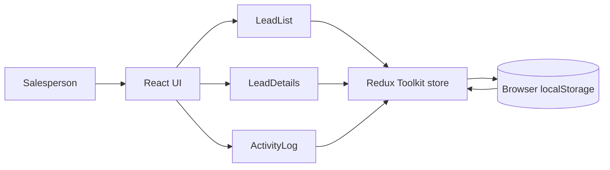

# System Design Summary

## 1. Overview
The Sales Lead Management Tool is a single-page React application designed for a sales team to review leads, inspect the selected lead in detail, and track follow-up activity. The workflow is intentionally simple and focused: select a lead from the list, view their information, and add notes to maintain an activity history.

## 2. Architecture
The application follows a lightweight frontend architecture built around a clear separation of responsibilities:

- Presentation layer: React components for the lead list, details panel, and activity log
- State layer: Redux Toolkit for centralized state management
- Persistence layer: browser localStorage for saving lead updates between refreshes
- Styling layer: CSS Modules for component-scoped styling

This structure keeps the app easy to understand, maintain, and extend without tightly coupling components to each other.

### Architecture and data flow

The salesperson selects a lead in `LeadList`. The selection is stored in Redux, and `LeadDetails` and `ActivityLog` display data for that lead. Submitting an activity dispatches an action that updates the lead in the store; the store subscription persists lead data to localStorage. The initial lead data is static, so no remote backend is used in this frontend implementation.

## 3. Data Model
The application state is built around a small but flexible CRM-style model.

### Lead model
Each lead contains:
- id
- name
- email
- phone
- activities

### Activity model
Each activity contains:
- text
- timestamp

The state stores:
- leads: an array of lead objects
- selectedLeadId: the currently active lead

This model supports both lead management and activity tracking in a single, consistent store.

## 4. Redux Flow
Redux Toolkit is used to centralize business logic and state changes.

The flow is straightforward:

1. The app initializes the Redux store with a predefined list of leads.
2. The user clicks a lead from the lead list.
3. The selectedLeadId is updated in the Redux slice.
4. Components subscribe to the relevant selector and re-render automatically.
5. When the user adds a new activity, the reducer appends the activity to the selected lead.
6. The state is persisted to localStorage to preserve the latest data after refresh.

This approach keeps state access predictable and avoids duplicate state management across components.

## 5. Component Responsibilities
### App.tsx
The main application shell that composes the lead list and lead detail/activity sections into a single dashboard layout.

### LeadList.tsx
Displays the leads in a list and allows the user to select one. Selected entries are visually highlighted to show the current focus.

### LeadDetails.tsx
Shows the selected lead's main information such as name, email, and phone number.

### ActivityLog.tsx
Displays the activity timeline for the selected lead and includes a form for submitting a new follow-up note.

Each component focuses on one responsibility, which makes the app easier to test and maintain.

## 6. Why React + TypeScript + Redux Toolkit
This technology stack was chosen for scalability, maintainability, and clarity.

- React enables efficient, component-based UI development.
- TypeScript improves reliability by enforcing types across the state model and component props.
- Redux Toolkit reduces repetitive Redux boilerplate and simplifies reducer logic.
- CSS Modules provide isolated styling and reduce class-name conflicts.

Together, these tools create a modern, structured frontend suitable for evaluation and future feature growth.

## 7. Validation and Quality Checks
The project includes automated tests that validate:
- reducer behavior for selecting leads
- reducer behavior for adding activities
- user flow for selecting a lead and logging activity

The app was also verified by running the project checks successfully:
- npm test -- --watchAll=false
- npm run build

These checks provide automated validation of the main workflow and confirm that a production bundle can be generated. They do not replace production monitoring.

## 8. Observability Strategy

This is a frontend prototype with static lead data and no remote backend. Current checks are the reducer and UI workflow tests, manual checks of lead selection and activity logging, and the production build. The app does not currently send telemetry to a monitoring service.

For a production version, I would add client-side error reporting for unexpected UI errors and failures to read or write local data. I would track basic, privacy-conscious events such as activity submission success or failure, without recording lead names, emails, phone numbers, or activity text. If a backend is introduced, request logs, latency metrics, and tracing would help diagnose service issues.

## 9. GenAI Use in the Design Phase

I used GenAI to help break the scenario into user flows, identify the lead and activity data needed, and compare a lightweight frontend design with a mocked backend against the assessment requirements. I chose a component-based React UI with Redux Toolkit because lead selection and activity updates are shared across the list, details, and activity views. I treated localStorage as the prototype's persistence mechanism and documented that the backend is mocked rather than a production service.

I reviewed the proposed design against the scenario requirements and refined it around the required workflow: view leads, select a lead, inspect details and activity history, and add a follow-up activity. I then checked the implementation with automated tests and a production build.

## 10. Conclusion
The Sales Lead Management Tool demonstrates a practical CRM-style interface built with modern frontend tooling. The design is intentionally simple and maintainable while still showing strong engineering practices such as typed state, centralized logic, modular components, and automated validation.
